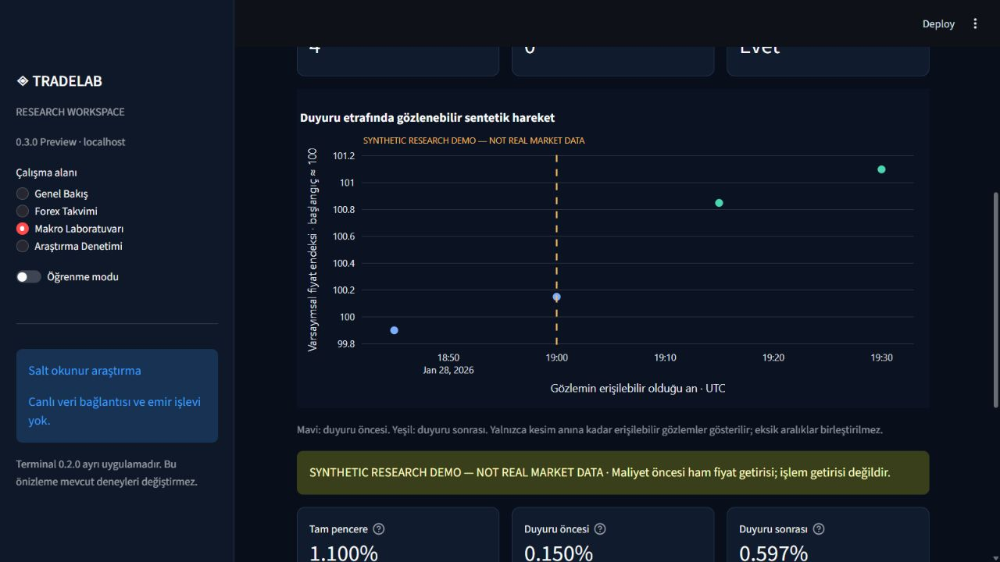

# TradeLab
### Quantitative Trading Research · Statistical Validation · Portfolio Analytics

[](https://github.com/yavuzaksoyy06-create/tradelab-research-portfolio/actions/workflows/public-tests.yml)

**Python · pandas · NumPy · SQL/SQLite · Streamlit · Plotly · Applied Statistics**

I started TradeLab to test whether ideas that look convincing on a price chart actually survive realistic assumptions, transaction costs, and statistical scrutiny.

My starting point was **support and resistance**. I wanted to turn discretionary chart patterns into rules I could explain, reproduce, and test without looking into future candles. The project later grew into a shared-capital portfolio simulator, a research terminal, and a financial data-quality workspace.

**Key result:** the three V4.1 S/R candidates lost money after assumed trading costs in the inspected historical replay. Rather than selecting a favorable chart or hiding a negative result, I kept the experiment and its limitations documented.

> **Scope:** Offline quantitative research, hypothetical execution and descriptive financial analytics. No profitable edge has been established; no broker orders have been sent. The historical research samples have already been examined and are not untouched out-of-sample evidence.

## Repository map

| Where to start | Directory | Purpose |
|---|---|---|
| **Core quantitative research** | [`research_sr_v4_1/`](research_sr_v4_1/) | Shared-cash portfolio, positions, risk constraints, timing controls and statistics |
| Research engine | [`research_sr_v4/`](research_sr_v4/) | Causal S/R features, trading sessions, signal rules, hypothetical fills |
| Explore results | [`research_terminal/`](research_terminal/) | Historical replay and research inspection; private original cache not included |
| **Financial research UI** | [`research_workspace/`](research_workspace/) | Treasury/ECB analysis, SQL catalog, data integrity and teaching modules |
| Earlier experiments | [`research_sr/`](research_sr/), [`research_sr_v2/`](research_sr_v2/), [`research_sr_v3/`](research_sr_v3/) | Historical prototypes, retained for source comparisons |
| Other research foundations | [`research_fx/`](research_fx/), [`research_crypto/`](research_crypto/), [`research_macro/`](research_macro/) | Calendars, availability rules and synthetic event-study contracts |
| Methods and evidence | [`docs/`](docs/), [`evidence/`](evidence/) | Historical reports, test records, reproducibility boundaries |

The original Python package paths remain intact because the frozen research protocol, tests, imports and source hashes depend on them. Earlier versions are **historical**, not separate production-ready products.

---

## 1. Support/resistance research: numerical results

### Study design

| Setting | Recorded specification |
|---|---|
| Universe | **MSFT, SPY, QQQ** |
| Data | 15-minute regular-session SIP bars, split-adjusted; **3,692 bars per symbol** |
| Total sample | 1 Apr–22 Oct 2026, **142 XNYS sessions** |
| Training diagnostic | 70 sessions (1 Apr–13 Jul) |
| Validation diagnostic | 30 sessions (14 Jul–24 Aug) |
| Inspected historical replay | **42 sessions (25 Aug–22 Oct)** |
| Initial capital | **$100,000 per candidate experiment**; shared cash across the three instruments within each experiment |
| Transaction cost assumption | **3 basis points per side**, zero percentage commission |
| Execution policy | Long-only, no overnight positions, up to four 15-minute bars per trade |
| Position/risk policy | Max 10% new-position notional, 0.5% planned risk, 30% opening aggregate exposure, up to three positions |

Spread and slippage costs are **model assumptions**, not measured execution costs. A daily risk lock does not prevent a loss larger than its threshold after a gap.

### V4.1: 42-session inspected replay

| Strategy | Signals | Executed trades | Active sessions | Net P&L | Net return | Max observed drawdown |
|---|---:|---:|---:|---:|---:|---:|
| **Support touch** | 103 | 53 | 28 | **-$93.36** | **-0.0934%** | 0.2335% |
| **Rejection** | 20 | 9 | 7 | **-$131.15** | **-0.1312%** | 0.1312% |
| **Trend filtered** | 6 | 4 | 4 | **-$24.88** | **-0.0249%** | 0.0520% |

These are three **separate candidate portfolios**, each initialized with $100,000. Their returns cannot be added to represent a single funded strategy.

### Matched timing controls and uncertainty

| Strategy | Candidate trades | Mean control trades | Mean daily candidate − control P&L | 95% descriptive paired bootstrap interval |
|---|---:|---:|---:|---|
| **Support touch** | 53 | 52.8 | **+$2.5740/day** | **[-$0.2866, +$6.4930]/day** |
| Rejection | 9 | 9.6 | -$0.4718/day | Not estimated: insufficient active sessions |
| Trend filtered | 4 | 4.0 | -$0.6855/day | Not estimated: insufficient active sessions |

The original comparison used **1,000 circular five-session block-bootstrap resamples**, retaining paired portfolio-session dependence. Five timing-control seeds were retained; they are simulations over the same market data, not independent observations.

The touch interval **includes zero**. Neither a statistically reliable improvement nor a causal S/R edge is established. The other two candidates have too few active sessions to estimate the specified intervals. A replay Sharpe ratio is not reported because the 42-session sample fails the experiment's minimum data gates.

### Cost sensitivity matters

In the separate **30-session validation** period, the support-touch candidate produced:

| Assumed cost per side | Net P&L |
|---|---:|
| 0 bp | +$30.45 |
| 3 bp | -$167.63 |
| 6 bp | -$364.79 |
| 10 bp | -$649.89 |

Under these assumptions, a small positive result without costs turns negative once trading friction is included. These validation numbers are from a **different time period** and should not be added to the replay results.

**Full tables, accounting checks and controls:** [S/R quantitative evidence](docs/SR_RESEARCH_EVIDENCE.md) · [Original V4.1 historical report](docs/v41-historical-research.md)

---

## 2. Multiple testing: what I can and cannot conclude

V4 validation documented **three entry definitions**, **three zone-width settings** and **four cost assumptions**: a **3 × 3 × 4 = 36-cell diagnostic configuration grid**. V4.1 subsequently evaluated three shared-capital candidate portfolios with five timing-control seeds.

These are not 36 independent discoveries: configurations overlap, candidates reuse data and the five control seeds are not independent market samples. Earlier V1–V3 prototypes also involved exploratory work; the available records do **not** establish an exact, deduplicated lifetime count of every trial.

This introduces **multiple-testing / data-snooping risk**. The chronological train/validation/replay split helps document the experiment, but all three intervals have since been inspected. The recorded paired confidence interval is **not multiplicity-adjusted**.

I have **not** calculated a Deflated Sharpe Ratio, White's Reality Check, Hansen's SPA, or a multiple-comparison-adjusted p-value. Those require a defensible trial inventory, aligned full return series and dependence-aware inference; summary P&L alone is not enough. They are possible directions for a **new, separately registered experiment**, not results being claimed here.

**Methods and counting boundaries:** [S/R research evidence](docs/SR_RESEARCH_EVIDENCE.md) · [Statistical methodology](docs/METHODOLOGY.md)

## 3. Research integrity and frozen protocol

Signals are formed only after the required price bars have completed. The hypothetical simulator then applies next-bar entry rules, capital limits, adverse transaction costs, conservative handling of ambiguous intrabar stop/target ordering and cash/equity reconciliation.

The original local V4.1 report records:
- **Local protocol freeze:** 23 October 2026, 18:41:04 UTC
- **Protocol SHA-256:** `93e311df4885c13823dbf0db705c75dd0c9c6488bf8d8b2d114de237d80c7f6b`
- **First public source snapshot:** [GitHub commit `780aab3`](https://github.com/yavuzaksoyy06-create/tradelab-research-portfolio/commit/780aab32ab4d96508911fcea6518985219993cf0), published **27 October 2026**

The local freeze timestamp is part of historical project evidence; the GitHub commit proves public availability **from 27 October**, not preregistration before the already-inspected replay. Creating a tag later cannot retroactively establish a 23 October public timestamp.

The separate prospective protocol specifies **60 sessions from 26 October 2026 to 21 January 2027**, with an earliest completion gate of **21 January 2027, 21:15 UTC**. The clock alone is insufficient: complete validated data and unchanged protocol conditions are required. No prospective performance is reported.

[Protocol and research provenance](docs/SR_RESEARCH_EVIDENCE.md)

---

## 4. Financial data engineering and analytics

I extended TradeLab to work with verified public daily reference data, including **US Treasury par yields** and **ECB FX reference rates**, while keeping them separate from intraday trading data.

### A practical data-quality case

The original Treasury parser silently omitted the official **1.5-month tenor** (`BC_1_5MONTH`) because its field-matching rule only recognized integer maturity names.

| Verified version | Observations |
|---|---:|
| Original Treasury 2025 snapshot | 3,237 |
| Valid observations recovered | **218** |
| New separately verified v2 derivative | **3,455** |

The fix uses explicit tenor definitions and a new version with parent lineage, without rewriting the old source files, checksums or manifests. It illustrates why a matching SHA-256 file hash **does not by itself guarantee complete semantic extraction**.

### Available analysis

- **Treasury:** observed yield curves, 10Y–2Y and 10Y–3M spreads, basis-point changes and inversion diagnostics.
- **ECB FX:** EUR/USD, EUR/GBP and other verified EUR-base series; simple/log returns, rolling non-annualized descriptive volatility and CSV exports.
- **SQL and validation:** SQLite joins/aggregations, row reconciliation, publication-reference comparisons, source/version metadata and rejected-data states.

The supplied 2025 Treasury and 2026 ECB observation periods do not overlap. The application does not manufacture a cross-market correlation or treat today's downloaded data as historical point-in-time vintages.

[Data-quality case study](docs/TREASURY_REMEDIATION.md) · [Financial analytics methodology](docs/FINANCIAL_ANALYTICS.md)

## Screenshots

Actual captured local UI screens, not generated mockups. Raw provider snapshots are intentionally excluded from the repository.

**Treasury yield-curve analysis**


**ECB reference-rate analysis**


**Synthetic macro event-study teaching lab**



---

## Running the public research workspace

Documented development environment: **Windows, Python 3.12**.

```powershell
git clone https://github.com/yavuzaksoyy06-create/tradelab-research-portfolio.git
cd tradelab-research-portfolio
python -m venv .venv
.\.venv\Scripts\python.exe -m pip install -r requirements.txt
.\.venv\Scripts\python.exe -B -m streamlit run research_workspace/app.py --server.address 127.0.0.1 --server.port 8502 --server.headless true --browser.gatherUsageStats false --theme.base dark
```

Open `http://127.0.0.1:8502/`. The workspace can display educational/synthetic modules without private provider data. Financial Analytics requires locally verified snapshots for real charts; it shows unavailable states rather than inventing values. The historical Research Terminal 0.2.0 requires excluded private research evidence and is not a ready-to-run historical replay from a fresh public clone.

**Optional external collection** (explicit command, not performed automatically):

```powershell
.\.venv\Scripts\python.exe -B -m research_workspace.real_sources collect --source ecb_fx
.\.venv\Scripts\python.exe -B -m research_workspace.real_sources collect --source treasury_2025
.\.venv\Scripts\python.exe -B -m research_workspace.real_sources review
```

These collect official *daily reference data*, not intraday prices. The legacy Treasury collector and the separately derived Treasury v2 version are described in [Financial Analytics](docs/FINANCIAL_ANALYTICS.md). Do not treat the v2 derivative as a newly published historical vintage.

### Tests and CI

```powershell
.\.venv\Scripts\python.exe -B tools/run_public_tests.py
```

- **Last published local evidence:** 379 tests, 378 passed, 1 Windows symlink-permission skip (28 October 2026).
- **GitHub Actions:** [Windows / Python 3.12 public-source workflow](.github/workflows/public-tests.yml). The badge above reflects GitHub's **actual workflow status**, not a manually asserted pass.
- **Platform limits:** The public test runner excludes private cached-price and frozen original research reproduction. Windows is the documented platform; Linux/macOS compatibility is **not certified**. The full frozen historical replay cannot be reproduced without the excluded original evidence.

[Validation scope and results](docs/VALIDATION.md) · [Recorded test evidence](evidence/public_test_results.json)

## Development history and limitations

TradeLab progressed from S/R prototypes (V1/V2), through explicit execution accounting (V3/V4), to synchronized shared-capital research (V4.1), a historical inspection terminal, verified public reference-data collection, SQL quality reports, and the Financial Analytics Lab.

The initial public commit on **27 October 2026** was a **curated snapshot of work developed locally across earlier stages**. It was not an attempt to recreate earlier chronological Git commits. Subsequent commits document the portfolio publication and follow-on data-analysis additions. See [development stages](docs/DEVELOPMENT_STAGES.md).

I use this project to practice making research decisions auditable: when a test cannot support a conclusion, the correct result is to document that uncertainty rather than turn it into a trading claim.

### More documentation

- [S/R numerical evidence, multiplicity and protocol](docs/SR_RESEARCH_EVIDENCE.md)
- [Original V4.1 historical report](docs/v41-historical-research.md)
- [Statistical methodology](docs/METHODOLOGY.md)
- [Data architecture](docs/ARCHITECTURE.md)
- [Financial analytics equations](docs/FINANCIAL_ANALYTICS.md)
- [SQL catalog and data quality](docs/SQL_CATALOG.md)
- [Validation and reproducibility](docs/VALIDATION.md)
- [Data provenance and publication policy](docs/DATA_AND_SECURITY.md)

Public references: [European Central Bank](https://www.ecb.europa.eu/stats/policy_and_exchange_rates/euro_reference_exchange_rates/html/index.en.html) and [US Treasury](https://home.treasury.gov/treasury-daily-interest-rate-xml-feed). No raw provider files, credentials, or private historical market caches are distributed in this repository. Public visibility does not, by itself, grant an open-source license.
