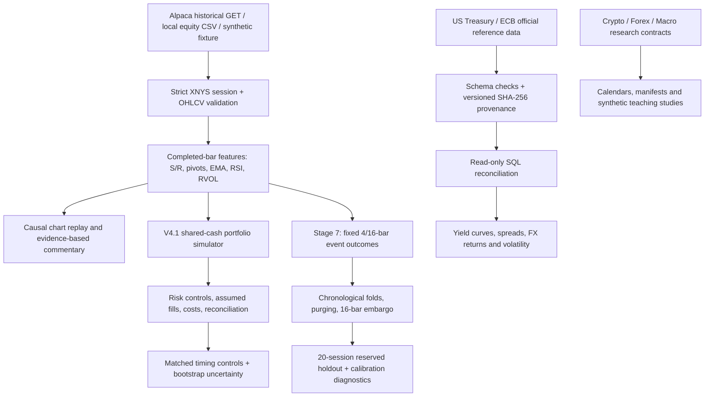
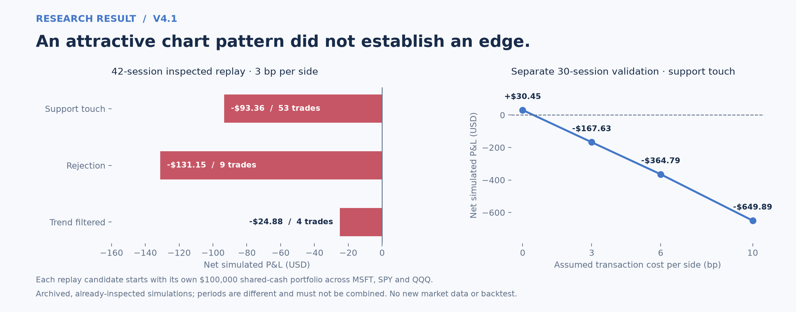
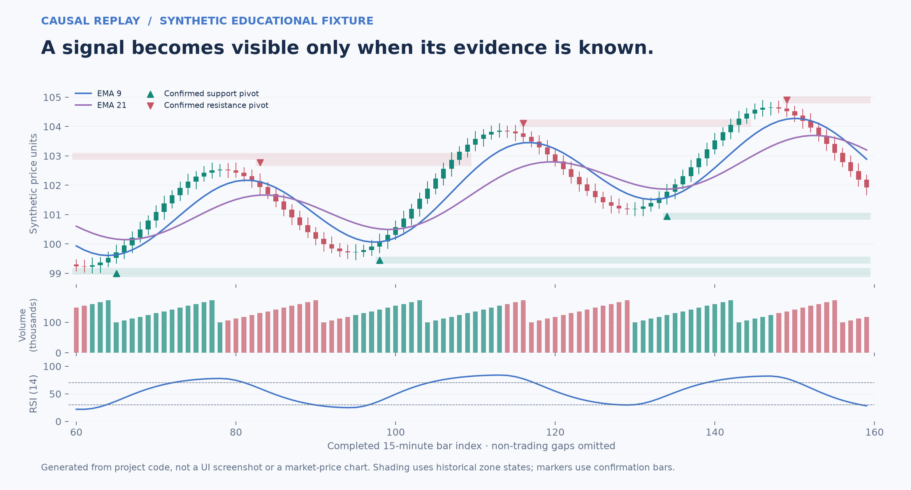

# TradeLab
### Quantitative Trading Research · Financial Data Engineering · Statistical Validation

**[▶ Launch Interactive Demo](https://demoapppy-c4xpccskhaougpyy4uwddk.streamlit.app/)** · [Explore the source](demo_app.py) · [Data and methods](docs/DEMO_REAL_DATA.md)

[](https://github.com/yavuzaksoyy06-create/tradelab-research-portfolio/actions/workflows/public-tests.yml)


**Python · pandas · NumPy · SQLite/SQL · Streamlit · Plotly · Statistical inference · Market-data validation**

I started TradeLab with a question that sounded simple: **when a support or resistance level looks convincing on a chart, does it still work after I define the rule, respect what was knowable at the time, simulate an actual portfolio, and pay trading costs?**

Instead of building a system that just draws buy/sell arrows, I built a research workflow: historical market-data validation, causal technical features, a shared-capital portfolio simulator, statistical comparisons, a replay terminal and a financial-data quality lab. The most valuable outcome has been learning **when the evidence does *not* support a trading claim**.

> **Research status:** No profitable trading edge has been established. Stage 7's probabilistic research pipeline has **not** been validated on real market outcomes, so its scenario probabilities remain disabled. This repository contains **no broker-order execution**, real or paper.

## Interactive demo — real historical AAPL market replay

The [Streamlit demo](demo_app.py) now opens with **506 real historical AAPL daily OHLCV observations (17 Feb 2015–16 Feb 2017)** from [Plotly's MIT-licensed sample-datasets repository](https://github.com/plotly/datasets/blob/master/finance-charts-apple.csv). **The chart is no longer synthetic**, and English evidence-based commentary describes the visible history.

The interface shows **daily candle replay, EMA20/50/200, Wilder RSI, relative volume and post-confirmation swing structure**, alongside separate archived strategy results, the Treasury/ECB data-quality case, and an expected-value sandbox. Its as-of cursor hides future days and plots pivots only after confirmation.

**Scientific boundary:** the public AAPL DAILY example is **not** a 15-minute V4/V4.1 research input and does not establish a trading edge. Original provider/adjustment provenance is not independently audited. No real-time API, credentials, uploads or broker orders are present in the demo.

**Run:** `streamlit run demo_app.py` · [Data provenance & methods](docs/DEMO_REAL_DATA.md) · [Deploy guide](docs/PUBLIC_DEMO.md). **Live Streamlit deployment:** [Open the interactive research terminal](https://demoapppy-c4xpccskhaougpyy4uwddk.streamlit.app/). The public URL was supplied by the repository owner; deployment availability is separate from the code and CI checks.

## Results worth seeing first

| Finding | Verified scope | Why it matters |
|---|---|---|
| **Transaction costs erased apparent performance** | **142 US-equity sessions**, 3 instruments; all **3** S/R portfolios lost money in the inspected **42-session** replay at **3 bp/side** | Profitability needs net execution economics, not a good-looking signal |
| **36 diagnostic configurations; no statistical edge declared** | 3 entry rules × 3 zone widths × 4 cost settings; paired bootstrap interval for the principal comparison **crossed zero** | A backtest can overstate certainty after repeated trials |
| **218 valid Treasury observations recovered** | Missing `BC_1_5MONTH` tenor; a separate version grew from **3,237 → 3,455** rows | A matching file hash does not prove a complete financial dataset |
| **A future-data leak was discovered and corrected** | Stage 7 replay/holdout audit; **9 adversarial regression tests** added | A green test suite is not enough without checking information timing |
| **485 Windows CI tests passed** | [Main branch Actions](https://github.com/yavuzaksoyy06-create/tradelab-research-portfolio/actions/runs/40872736674), 0 failed, 0 skipped; isolated Linux demo smoke tests passed | Public software contracts are tested; **not** a proof of trading profitability |

**Where to start:** **2 minutes** — read the findings above and the figures below; **5 minutes** — open the [Treasury remediation](docs/TREASURY_REMEDIATION.md) and [look-ahead audit](docs/STAGE7_AUDIT.md); **15 minutes** — inspect the [S/R evidence](docs/SR_RESEARCH_EVIDENCE.md), [Stage 7 protocol](docs/STAGE7_RESEARCH_PROTOCOL.md), and run the offline test suite.

## Market coverage and data sources

I deliberately separate *actual sourced observations*, *hypothetical portfolio calculations*, and *synthetic/contract-only research*. They are not interchangeable.

| Market / source | Implemented capability | Data status and limitations |
|---|---|---|
| **US equities: SPY, MSFT, QQQ** | 15-minute OHLCV, historical S/R, volume, technical overlays, portfolio research and replay | Earlier V4.1 study uses **3,692 split-adjusted SIP bars per symbol** from 1 Apr–22 Oct 2026; original licensed price cache is **not published** |
| **Alpaca Market Data API** | **Optional, manually triggered, read-only HTTPS GET** for completed 15-minute US-equity bars; select **IEX or entitled SIP**; session coverage and provider metadata checked | Historical data, **not** a live trading feed or Alpaca brokerage order connection. Chart reader limits requests to **10 complete XNYS sessions**; feed entitlement and point-in-time authenticity are not independently certified |
| **US Treasury** | Official 2025 daily par-yield XML ingestion, versioned normalized observations, 10Y–2Y / 10Y–3M spreads, yield curves, basis-point changes | Official public *reference observations*; prior parser defect corrected in a **new derived version** without overwriting raw evidence |
| **European Central Bank** | Official EUR-base daily FX reference rates; EUR/USD and EUR/GBP transformations, simple/log returns and descriptive rolling volatility | ECB **reference rates**, not executable broker prices. Collection snapshot time is not a historical publication vintage |
| **Forex research** | Time-zone aware market-session calendars, New York DST transitions, rollover and validation contracts | **Session infrastructure / educational scenarios**; no claim of a licensed real-time FX feed |
| **Crypto research** | 24/7 UTC calendar, completeness rules and versioned dataset-manifest contracts | **Calendar and provenance infrastructure**; no live exchange integration or verified historical performance claimed |
| **Macro & event studies** | Release-availability checks, source/document provenance and event-study teaching cases | Educational fixtures are **explicitly synthetic**; no market-wide predictive macro signal is claimed |
| **Local research CSV** | Validated user-supplied 15-minute OHLCV in the Equity Research page | Uploaded origin is **not independently verified**; invalid, duplicate or incomplete sessions are rejected |

The **Alpaca historical reader** and the **Stage 7 optional private-history collector** are distinct: the latter has stricter research-registration, feed and date limits, works only with explicit consent and stores a private snapshot outside Git. Neither submits orders. The separate personal Alpaca paper-trading environment is **not a public execution feature of this repository**.

[Equity Research data contract](docs/EQUITY_RESEARCH_LAB.md) · [Financial analytics methodology](docs/FINANCIAL_ANALYTICS.md) · [Data and security](docs/DATA_AND_SECURITY.md)

## How the research system works



**Crucial boundary:** Stage 7 is a **directional research and diagnostic pipeline**, not an order execution engine. Its output is not a validated price forecast or recommendation. Financial-reference and equity-history datasets remain different frequencies and vintages; the app does not fabricate correlations between them.

## What I implemented

| Research layer | Concrete implementation | Reason for building it |
|---|---|---|
| **Causal technical research** | Confirmed swing points and **HH/HL/LH/LL** structure; support/resistance zone lifecycles; non-backdated trendlines; **EMA 9/21/50/200, Wilder RSI(14), RVOL(20)** | Prevent information from later candles appearing in an earlier decision |
| **Multi-asset portfolio simulation** | Three-symbol synchronized timeline, a single shared cash account, deterministic allocation priority, next-bar hypothetical fills and conservative ambiguous-candle treatment | Measure what capital could actually support instead of summing separately funded trades |
| **Risk and execution assumptions** | Up to 3 positions; 10% maximum new-position notional; 30% aggregate opening exposure; 0.5% planned risk; no overnight positions; up to four 15-minute bars per trade | Make exposure, costs, stops and accounting explicit |
| **Quantitative evaluation** | 36-cell sensitivity study, matched timing controls, session-block bootstrap, cost sensitivity, chronological splits and multiple-testing disclosures | Distinguish fragile in-sample patterns from defensible evidence |
| **Equity Research UI** | Plotly candles and volume, session-compressed time axis, replay cursor, active zones, confirmed structure and deterministic **Turkish** commentary linked to numeric evidence | Inspect what a trader could have known at each historical bar close |
| **Stage 7 research** | Fixed 4/16-completed-bar outcomes; expanding training folds, label purging, 16-bar embargo, smoothed conditional frequencies and four baselines; Brier/log loss and calibration | Investigate conditional outcomes without confusing explanatory rules with predictive advantage |
| **Financial data engineering** | Official-source collectors, TLS and request controls, immutable new snapshot versions, raw/normalized hashes, SQLite joins/reconciliation, Treasury and ECB analysis | Establish data lineage and identify missing or misparsed market-reference observations |

**Source paths:** [Equity workspace](research_workspace/) · [Portfolio research](research_sr_v4_1/) · [Frozen S/R engine](research_sr_v4/) · [Historical terminal](research_terminal/) · [Validation evidence](evidence/).

## Research finding 01 — a strategy can look better before costs



The study contains **142 regular US-equity sessions** (1 Apr–22 Oct 2026); the original exploratory split had 70 training, 30 validation and 42 inspected replay sessions. The numbers below are from the **42-session historical replay (25 Aug–22 Oct)**, with hypothetical **$100,000 starting cash per candidate portfolio**, a **3 bp transaction cost per side**, long-only execution and no overnight holdings.

| Candidate | Trades | Net P&L | Net return | Maximum drawdown |
|---|---:|---:|---:|---:|
| Support touch | 53 | **−$93.36** | −0.0934% | 0.2335% |
| Rejection | 9 | **−$131.15** | −0.1312% | 0.1312% |
| Trend filtered | 4 | **−$24.88** | −0.0249% | 0.0520% |

These are **three separately funded hypothetical portfolio experiments**. Do not add their P&L as if they belonged to one account.

The **support-touch** candidate's average daily return difference versus matched timing controls corresponded to **+$2.5740/day**, but its descriptive **95% paired bootstrap interval was [−$0.2866, +$6.4930] per day** — it spans zero. This is not evidence of a statistically robust S/R edge, and the interval is **not adjusted for multiple comparisons**. Rejection and trend-filtered candidates had too few active sessions for the stated interval procedure.

**Separate 30-session validation cost sensitivity** (not added to replay totals):

| Assumed trading cost, each side | Support-touch net P&L |
|---|---:|
| 0 bp | +$30.45 |
| 3 bp | −$167.63 |
| 6 bp | −$364.79 |
| 10 bp | −$649.89 |

**My takeaway:** a rule is not a strategy advantage until it survives realistic costs, funding constraints and statistical comparisons. I kept the negative results rather than tune the README around a favorable chart.

[Full numerical evidence](docs/SR_RESEARCH_EVIDENCE.md) · [Original historical report](docs/v41-historical-research.md) · [Methods](docs/METHODOLOGY.md)

## Research finding 02 — replay must respect what was knowable



**This figure is synthetic educational data, not real SPY prices or a screenshot of a live terminal.** It is generated from the project's causal-feature code. Historical S/R bands retain their bar-close states; pivots and trendlines appear **only after confirmation**, not retroactively on the chart. Past replay positions cannot see future event outcomes.

A confirmed pivot needs later bars to become observable. That is why a visually obvious swing low **cannot** automatically become a valid signal at the low itself. Technical indicators are computed from completed bars, with explicit lookback requirements. The commentary is a transparent, **rule-based descriptive engine**, not an LLM generating price predictions.

[Chart specification](docs/EQUITY_RESEARCH_LAB.md) · [Structure and commentary methods](docs/EQUITY_STRUCTURE_COMMENTARY.md) · [How figures were reproduced](docs/images/README.md)

## Research finding 03 — data quality can fail without a corrupted file

The Treasury parser initially failed to recognize the official **1.5-month maturity** (`BC_1_5MONTH`). Source-file hashes were valid, but the extracted dataset was incomplete.

| Dataset version | Observations |
|---|---:|
| Earlier 2025 Treasury snapshot | 3,237 |
| Valid maturity observations recovered | **+218** |
| New verified derivative | **3,455** |

I introduced explicit series definitions, source checks, derived version identifiers and parent lineage rather than silently rewriting the original. This taught me to separate **byte integrity**, **schema correctness** and **semantic completeness**.

**Actual locally captured analytics views** (not generated market-data screenshots):


[Treasury case study](docs/TREASURY_REMEDIATION.md) · [SQL catalog and quality reports](docs/SQL_CATALOG.md)

## Research finding 04 — the holdout leak I found and fixed

In the first Stage 7 implementation, final **20-session holdout** observations were excluded from model validation but **their outcomes could still become visible in replay**. Truncating the dataset to a replay cursor also inadvertently **moved the holdout boundary**. Two extra code paths accepted invalid indices or unsafe private-snapshot metadata.

I reproduced these defects with adversarial tests and then changed the design:

1. **One fixed, full-snapshot partition** determines the holdout boundary across charts, event labels, model fitting and replay.
2. **Registered input fingerprints** reject modified or truncated private research snapshots rather than quietly shifting the evaluation interval.
3. **Strict indices, date gates and metadata allowlists** prevent malformed access and sensitive fields being written to private manifests.
4. **Nine new adversarial tests** cover these regression cases; the audited Windows Actions run passed **477/477 offline public tests**.

Stage 7 compares fixed 4- and 16-bar outcomes with four baselines using chronological folds, purging, a 16-bar embargo, calibration and session-block uncertainty. **It has not yet run a qualifying real-market predictive evaluation.** A previously viewed historical period cannot be described as untouched out-of-sample evidence.

[Stage 7 audit](docs/STAGE7_AUDIT.md) · [Registered protocol](docs/STAGE7_RESEARCH_PROTOCOL.md) · [Validation report](docs/STAGE7_VALIDATION_REPORT.md)

## Reliability, reproducibility and boundaries

- **Software tests:** [477 passed, zero skipped/failed on Windows CI](https://github.com/yavuzaksoyy06-create/tradelab-research-portfolio/actions/runs/40858054701) at the audited checkpoint; local Windows evidence had one environment-dependent symlink skip. CI covers causal feature timing, holdout isolation, data and manifest validation, provider GET transport, numerical checks and Streamlit UI behavior.
- **Platform scope:** Windows / Python 3.12 is CI-verified. An exploratory Ubuntu run exposed **14 Windows-only immutable-publication test errors** (`No-replace publication requires Windows`); Linux is **not certified**. The source-integrity guard was not weakened, and the Windows test selection remains intact.
- **No look-ahead by construction:** features and signals follow completed-bar confirmation; the reserved historical holdout is hidden across eligible long-data replay, training and diagnostics.
- **Public-data limits:** frozen historical market-price caches and original licensed evidence are excluded. A fresh clone can run the clearly labeled synthetic UI and public tests, **not reproduce the original private-price backtest**.
- **Research scope:** no broker execution; no validated trading alpha; no calibrated bullish/bearish probabilities or real Stage 7 performance statements. The frozen V4.1 prospective evaluation gate is **21 January 2027, 21:15 UTC**. Stage 7 independently rejects dates on/after 26 October 2026.

The initial public repo is a *curated snapshot* of earlier work rather than fabricated chronological Git history. Earlier V1–V4.1 folders remain in their original import paths because tests, frozen hashes and source provenance depend on those paths; moving them to `archive/` would break that contract. [Development timeline](docs/DEVELOPMENT_STAGES.md) · [Data and security](docs/DATA_AND_SECURITY.md)

### Run it locally

**Windows / Python 3.12**, with no private data or API credentials:

```powershell
git clone https://github.com/yavuzaksoyy06-create/tradelab-research-portfolio.git
cd tradelab-research-portfolio
py -3.12 -m venv .venv
.\.venv\Scripts\python.exe -m pip install -r requirements.txt
.\.venv\Scripts\python.exe -B tools/run_public_tests.py
.\.venv\Scripts\python.exe -B -m streamlit run research_workspace/app.py --server.address 127.0.0.1 --server.port 8502 --browser.gatherUsageStats false
```

**Linux / macOS — exploratory, not certified:** These commands are provided as guidance only. The existing immutable-publication workflow includes a Windows-specific safety primitive; full tests may fail on Linux.

```bash
git clone https://github.com/yavuzaksoyy06-create/tradelab-research-portfolio.git
cd tradelab-research-portfolio
python3.12 -m venv .venv
source .venv/bin/activate
pip install -r requirements.txt
python -B tools/run_public_tests.py
streamlit run research_workspace/app.py --server.address 127.0.0.1 --server.port 8502 --browser.gatherUsageStats false
```

Open **http://127.0.0.1:8502/** and choose **Equity Research** for the synthetic offline chart. The **Alpaca read-only history** path requires your own local credentials, an entitled feed and an explicit Load action; never commit keys or put them in a public deployment. A hosted Streamlit demonstration is **not currently claimed**; local synthetic mode is the reproducible entry point.

[Full setup and reader constraints](docs/EQUITY_RESEARCH_LAB.md) · [Optional private Stage 7 collection](docs/STAGE7_LIMITATIONS.md) · [Validation evidence](docs/VALIDATION.md)


### Reference index

[Research evidence](docs/SR_RESEARCH_EVIDENCE.md) · [Methodology](docs/METHODOLOGY.md) · [Architecture and data contracts](docs/ARCHITECTURE.md) · [Financial analytics](docs/FINANCIAL_ANALYTICS.md) · [SQL catalog](docs/SQL_CATALOG.md) · [Stage 7 checkpoint](docs/STAGE7_CHECKPOINT.md) · [Figure provenance](docs/images/README.md)

**Author:** Yavuz Kaan Aksoy — Economics graduate, quantitative trading and financial analytics research.

_External references: [Alpaca Market Data](https://docs.alpaca.markets/us/reference/stockbars) · [US Treasury](https://home.treasury.gov/treasury-daily-interest-rate-xml-feed) · [European Central Bank](https://www.ecb.europa.eu/stats/policy_and_exchange_rates/euro_reference_exchange_rates/html/index.en.html). GitHub visibility alone does not grant a redistribution license for market-data snapshots._
