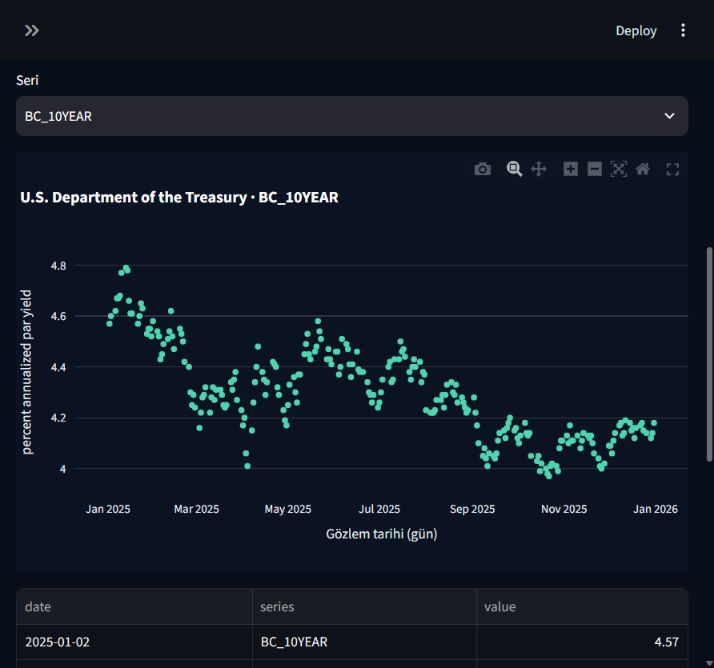

# TradeLab — Auditable Quantitative Research Workspace

**Python · applied statistics · data quality · reproducible experiments · Streamlit · SQL/SQLite**

A portfolio project about turning financial observations into **inspectable research evidence**. It combines causal support/resistance experiments, shared-capital portfolio accounting, calendar-aware validation, immutable dataset snapshots and an interactive research workspace.

The central question is not “can a chart look convincing?” It is **“what was known at the decision time, which assumptions produced this result, and can someone verify it?”**

> Research software, not an investment product. No robust trading advantage has been demonstrated. No live, paper or replay orders were submitted. Historical observations already inspected are not an untouched holdout.

## Start here

- [Development stages and decisions](docs/DEVELOPMENT_STAGES.md)
- [Architecture and data contracts](docs/ARCHITECTURE.md)
- [Statistical methodology and limitations](docs/METHODOLOGY.md)
- [Validation evidence and reproduction boundaries](docs/VALIDATION.md)
- [Data provenance, security and publication policy](docs/DATA_AND_SECURITY.md)
- [Türkçe proje özeti ve CV metni](docs/CV_TR.md)

## What is implemented

| Area | Implemented capability | Important boundary |
|---|---|---|
| Causal features | Confirmation-time pivots, ATR-based zones, completed-bar signals, lifecycle tracking | No future candles used to confirm a current signal |
| Offline simulation | Next-bar entries, transaction costs, gaps, ambiguous intrabar ordering, cash/equity reconciliation | Hypothetical fills; no broker execution |
| Portfolio research | Shared cash, deterministic allocation, aggregate exposure, daily risk lock and ledgers | Losses can exceed planned risk during gaps |
| Applied statistics | Chronological diagnostics, matched timing controls, session-block bootstrap, sample-size gates, sensitivity analysis | Descriptive uncertainty is not proof of causality or alpha |
| Data engineering | OHLCV validation, exchange/session calendars, UTC normalization, hashes and versioned manifests | Byte integrity does not prove economic truth |
| Macro research | Source/document review schema, availability timestamps, incomplete-window rejection | Workspace event-study examples are synthetic |
| Multi-market calendars | Crypto 24/7 grid and Forex NY/DST/rollover handling | FX provider profile is explicitly hypothetical |
| Real public sources | ECB daily reference FX and US Treasury historical daily par yields | Not intraday OHLCV or point-in-time release vintages |
| Communication | Turkish learning mode, charts, data tables, rejection reasons and audit views | No invented values for unavailable evidence |
| Relational SQL catalog | Verified sources, versions and observations; JOIN/GROUP BY coverage, row reconciliation, observed-grid quality and gap diagnostics in SQLite | In-memory, fixed read-only reports; no warehouse or predictive ML pipeline |

## Screenshots

The screenshots below were captured from the original local application, not generated mockups. Raw provider datasets are intentionally not redistributed in this repository.

### Real daily reference data



### Synthetic event-study teaching lab


## Run the public workspace

Recommended environment: **Windows, Python 3.12**. The immutable publisher deliberately relies on Windows no-replace rename semantics. Do not interpret it as portable write-once storage.

```powershell
python -m venv .venv
.\.venv\Scripts\python.exe -m pip install -r requirements.txt
.\.venv\Scripts\python.exe -B -m streamlit run research_workspace/app.py --server.address 127.0.0.1 --server.port 8502 --server.headless true --browser.gatherUsageStats false --theme.base dark
```

Open `http://127.0.0.1:8502/`.

The synthetic calendar and event-study pages work without provider accounts. In this public copy, frozen private-cache evidence is **unavailable**, not green: protected original outputs, historical price caches and workstation test evidence are intentionally absent. The older Terminal 0.2.0 requires that excluded local evidence and is included as source for inspection, not as a ready-to-run public historical dashboard.

Optional public reference collection (explicit network access, no credentials):

```powershell
.\.venv\Scripts\python.exe -B -m research_workspace.real_sources collect --source ecb_fx
.\.venv\Scripts\python.exe -B -m research_workspace.real_sources collect --source treasury_2025
.\.venv\Scripts\python.exe -B -m research_workspace.real_sources review
```

These commands create new local versions; they do not update frozen V4.1 research. The Treasury adapter is deliberately fixed to **2025**; the ECB feed contains the most recent 90 days. Collection results will differ by collection time. Hash verification requires the collector code to remain unchanged after collection.

On the **Gerçek Veri** page, expand **SQL katalog raporu** and click **SQL raporunu doğrula ve göster**. Each request revalidates snapshots before loading an ephemeral SQLite database. Rejected versions retain their rejection reason but contribute no observations. With no collected data, reports are empty rather than successful data verification. See [SQL catalog design and limitations](docs/SQL_CATALOG.md).

Run the portable-source test selection on Windows:

```powershell
.\.venv\Scripts\python.exe -B tools/run_public_tests.py
```

Current Windows test selection: **379 tests, 378 passed, 1 symlink-permission skip**. Quality reports compare series against dates observed within the same version; a pinned ECB TARGET profile and Treasury 2025 published-date reference now supplement that grid. Unreviewed ranges remain unknown. See [publication reference review](docs/PUBLICATION_CALENDARS.md).

Read [validation](docs/VALIDATION.md) before interpreting counts. Full archived research runners need excluded private caches/checkpoints and must not be represented as passing in a fresh clone.

## Repository structure

```text
research_sr/          early support/resistance prototype
research_sr_v2/       revised causal feature experiments
research_sr_v3/       explicit hypothetical execution model
research_sr_v4/       calendar/data quality, causal engine, experiments
research_sr_v4_1/     synchronized portfolio, controls, statistics, frozen protocol
research_terminal/   historical replay, decision inspector, provenance/intake
research_crypto/     24/7 calendar and strict dataset manifest contracts
research_macro/      event/source/document availability and event studies
research_fx/         NY sessions, DST and rollover validation
research_workspace/  synthetic labs, audit view, real daily source snapshots
docs/                development narrative, methodology and publication boundaries
evidence/            source fingerprints and public-package test evidence
tools/               explicitly scoped public reproduction commands
```

## Research results: what can and cannot be claimed

In the original 42-session observed replay, all three V4.1 candidate variants lost money after the configured costs. The touch candidate's descriptive paired interval against matched timing controls included zero; other candidate samples were too sparse for the interval gate. This is a useful negative research result, not a profitable strategy claim. [Archived methodology and results](docs/v41-historical-research.md).

The frozen prospective window cannot complete before **21 January 2027, 21:15 UTC**. Passing that clock threshold alone is insufficient: complete validated data and all protocol requirements remain necessary. The workspace contains no prospective evaluator and no bypass.

## Relevance to analytics consulting

This project demonstrates a workflow transferable to transaction-level business analytics: define a data contract, reject unreliable inputs, distinguish observation time from availability, compare against controls, quantify uncertainty, preserve an audit trail and communicate limitations to decision makers.

It does **not** demonstrate a client engagement, deployed credit/insurance model, production-scale database, multivariate predictive model or measured business uplift. SQL evidence now includes a small relational catalog, parameterized loading, version-isolated aggregation and tested rejection paths; it does not imply production-scale database experience. Future work is clearly separated in the development document.

## Attribution and authorship

Project owner: **Yavuz Kaan Aksoy**. Developed iteratively with AI coding assistance (including Codex). This repository records implementation and test evidence; authorship does not imply every line was written unaided. Interview explanations should focus on design choices and limitations the owner can personally defend.

Sources: [ECB reference rates](https://www.ecb.europa.eu/stats/policy_and_exchange_rates/euro_reference_exchange_rates/html/index.en.html), [US Treasury XML feeds](https://home.treasury.gov/treasury-daily-interest-rate-xml-feed). Third-party libraries are installed separately and are not vendored here. No open-source license grant is added by this publication; public visibility alone is not a redistribution license for third-party data.

## Stage 5 — Financial Analytics Lab

Offline Treasury revision 2 uses explicit maturity definitions, including the 1.5-month tenor. It derives a separately pinned immutable snapshot from an already verified legacy version; original snapshots and collector remain unchanged. No automatic downloads. Financial Analytics now includes Treasury curves/spreads/basis-point changes, ECB simple/log changes and non-annualized rolling volatility, CSV metadata and explicit overlap rejection.


- [Financial equations, data flow and authentic screens](docs/FINANCIAL_ANALYTICS.md)
- [Treasury completeness remediation case study](docs/TREASURY_REMEDIATION.md)
- [Stage 5 Turkish delivery report](docs/STAGE5_DELIVERY_TR.md)

For a business audience: the lab turns verified public reference data into traceable
interest-rate and currency summaries. It detects omitted data, preserves prior
versions, explains calculations and declines comparisons when periods do not overlap.
This supports trustworthy analytical communication; it does not claim deployed
commercial impact, forecasting accuracy or investment performance.
