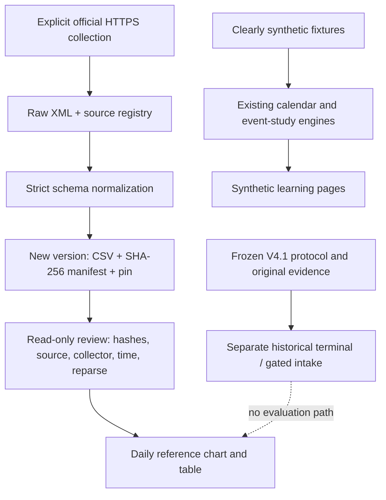
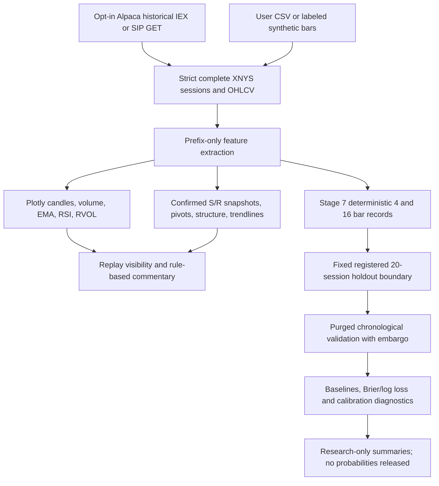

# Architecture and data contracts



## Boundaries

- `research_workspace` presents adapter outputs; it does not route orders.
- `real_sources.py` handles explicit public **daily Treasury/ECB reference** collection; the separate `equity_provider.py` is a user-initiated, GET-only **historical equity** reader. The financial-reference UI reader never calls the daily collector automatically.
- `research_terminal.provenance` provides existing safe filename, regular-file and exclusive JSON creation helpers. Its prospective build/review flow is not repurposed for daily reference data.
- Frozen research engines retain their own contracts and source hashes. Public export excludes the original evidence needed to reproduce every historical run; absence is visible.
- Source import is not a command to run historical ingestion. The optional older V4 data collector requires separate credentials/dependencies that are not part of the default demo setup.

## Daily source contract

Normalized columns: `date`, `series`, `value`, `available_at`.

- ECB values are units of quote currency per EUR, not a broker bid/ask midpoint.
- Treasury values are annualized par yields in percent; they are not price returns.
- Observation date is only a day label. No publication clock is invented.
- `available_at` is the first local collection timestamp for the entire snapshot.
- Duplicate keys, invalid/nonfinite rates, empty results, unexpected schemas and future dates fail validation.
- Missing observations stay missing; charts show points without inventing a continuous traded path.

## Snapshot contract

`raw.xml`, `observations.csv` and `registry.json` are individually hashed in `manifest.json`. The manifest includes source URL, collection time, coverage, row count, HTTP metadata and collector code digest. A separate `.pin.json` refers to the manifest digest. Review checks an exact file set and reproduces CSV from the checked raw bytes.

Collector source changes invalidate old snapshots for the current reader. The user can retain old evidence and collect a new version; there is no automatic acceptance of changed code. A crash before pin creation leaves an unlisted folder rather than a verified dataset.

## Causal experiment contract

Signals become available after their required candles close. A pivot that needs right-hand candles becomes known only at confirmation. Execution begins no earlier than the next same-session bar. Incomplete hourly features cannot leak into a 15-minute decision. Missing/invalid input aborts the calculation rather than being repaired invisibly.

## SQL scope in the original implementation

The historical ingestion module uses SQLite:

```sql
CREATE TABLE IF NOT EXISTS datasets (
    sha256 TEXT PRIMARY KEY,
    metadata TEXT NOT NULL
);
```

Writes use placeholders rather than interpolating metadata into SQL. This provides a small local dataset index, not normalized multi-table analytical modeling. The subsequent SQL catalog adds three related in-memory tables and fixed coverage/reconciliation queries; see [the SQL design](SQL_CATALOG.md). It is a separate later stage, not an achievement attributed to the historical ingestion implementation.

## Stage 5 extension

The Financial Analytics view is isolated from frozen engines. `treasury_v2.py` derives and reviews offline parent-linked revisions; `financial_analytics.py` owns pure descriptive transforms and metadata exports; `financial_ui.py` only reads catalogs and renders those results. The legacy collector is unchanged. See [equations and data flow](FINANCIAL_ANALYTICS.md).

## Stage 6–7 extension — historical equity research (29 October 2026)

The read-only equity analysis and conditional-outcome research are **separate from** the historical V4/V4.1 execution experiments and the daily-reference data pipeline.



**Source contracts and separation.** The Equity Research screen accepts only SPY, MSFT or QQQ and exact completed 15-minute regular-session bars. The Alpaca history reader is opt-in, uses only HTTPS GET and keeps key/secret in the local environment. It preserves explicit IEX/SIP feed identity and rejects incomplete sessions; IEX data must not be silently treated as SIP. A provider response is not an independently certified historical vintage. Uploaded CSV bytes and returned price data are not published by the app.

**Causal replay and information access.** Indicators and historical zone states are recalculated only from completed visible bars. Pivots appear at confirmation, and confirmed trendline segments are not drawn into past observations. For sufficiently long Stage 7 snapshots, the final 20 complete sessions are **not** available through chart cursors, outcome labels or model metrics; replay cannot move this partition. Data must retain the registered canonical fingerprint and count. A period already viewed before the leak fix cannot be reclassified as unseen.

**Statistical meaning.** Stage 7 records 4/16-bar endpoint directions and specified S/R paths but does **not** model real trading fills, costs or P&L. Its four baselines and conditional frequencies are research diagnostics; a qualifying real-market Stage 7 evaluation has not run. V4/V4.1 research files remain unchanged and the prospective 2027-01-21 gate is independent. No order router or live/paper brokerage integration is included in the public package.

**Platform scope.** The verified public test contract is Windows/Python 3.12. A Linux compatibility probe found 14 errors in Windows-specific immutable/no-replace data-publication tests; the guard is retained rather than bypassed. Other parts may run on Linux, but full cross-platform correctness is not claimed.

References: [Equity source/reader contract](EQUITY_RESEARCH_LAB.md), [Stage 7 protocol](STAGE7_RESEARCH_PROTOCOL.md), [leakage audit](STAGE7_AUDIT.md), [validation evidence](STAGE7_VALIDATION_REPORT.md).
