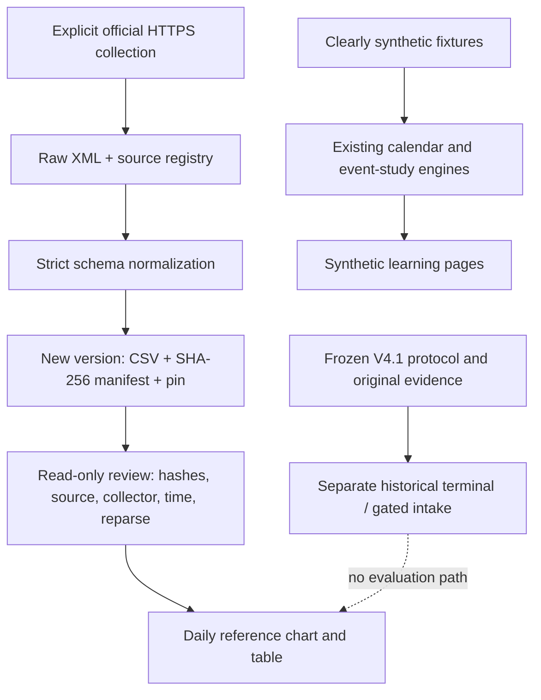

# Architecture and data contracts



## Boundaries

- `research_workspace` presents adapter outputs; it does not route orders.
- `real_sources.py` is the only new public reference downloader. Its UI reader never calls collection.
- `research_terminal.provenance` provides existing safe filename, regular-file and exclusive JSON creation helpers. Its prospective build/review flow is not repurposed for daily reference data.
- Frozen research engines retain their own contracts and source hashes. Public export excludes the original evidence needed to reproduce every historical run; absence is visible.
- Source import is not a command to run historical ingestion. The optional older V4 data collector requires separate credentials/dependencies that are not part of the default demo setup.

## Daily source contract

Normalized columns: `date`, `series`, `value`, `available_at`.

- ECB values are units of quote currency per EUR, not a broker bid/ask midpoint.
- Treasury values are annualized par yields in percent; they are not price returns.
- Observation date is only a day label. No publication clock is invented.
- `available_at` is the first local collection timestamp for the entire snapshot.
- Duplicate keys, invalid/nonfinite rates, empty results, unexpected schemas and future dates fail validation.
- Missing observations stay missing; charts show points without inventing a continuous traded path.

## Snapshot contract

`raw.xml`, `observations.csv` and `registry.json` are individually hashed in `manifest.json`. The manifest includes source URL, collection time, coverage, row count, HTTP metadata and collector code digest. A separate `.pin.json` refers to the manifest digest. Review checks an exact file set and reproduces CSV from the checked raw bytes.

Collector source changes invalidate old snapshots for the current reader. The user can retain old evidence and collect a new version; there is no automatic acceptance of changed code. A crash before pin creation leaves an unlisted folder rather than a verified dataset.

## Causal experiment contract

Signals become available after their required candles close. A pivot that needs right-hand candles becomes known only at confirmation. Execution begins no earlier than the next same-session bar. Incomplete hourly features cannot leak into a 15-minute decision. Missing/invalid input aborts the calculation rather than being repaired invisibly.

## SQL scope in the original implementation

The historical ingestion module uses SQLite:

```sql
CREATE TABLE IF NOT EXISTS datasets (
    sha256 TEXT PRIMARY KEY,
    metadata TEXT NOT NULL
);
```

Writes use placeholders rather than interpolating metadata into SQL. This provides a small local dataset index, not normalized multi-table analytical modeling. The subsequent SQL catalog adds three related in-memory tables and fixed coverage/reconciliation queries; see [the SQL design](SQL_CATALOG.md). It is a separate later stage, not an achievement attributed to the historical ingestion implementation.
