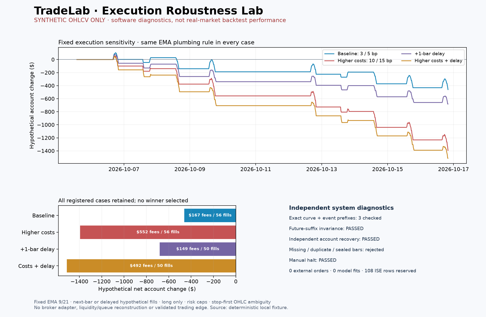

# Execution Robustness Lab

I added a separate execution-engineering layer to close a gap between model research and an operable trading system: a signal alone does not explain when an entry was knowable, how capital was allocated, why an exit occurred, or whether the resulting account can be independently reconstructed.

This milestone implements a deterministic, event-sourced **offline** rehearsal, independent account recovery and an adversarial execution diagnostic suite. It is a working software foundation, **not a live or broker-paper trading bot**. The original V4.1 portfolio research remains separate and unchanged.

## Implemented architecture

```mermaid
flowchart LR
    A[Completed OHLCV snapshot] --> B[Calendar, provenance and sealed-period checks]
    B --> C[Full-snapshot holdout boundary]
    C --> D[Visible completed-bar prefix]
    D --> E[Fixed EMA 9/21 plumbing rule]
    E --> F[Unique pending intent]
    F --> G[Next-bar or delayed risk check]
    G --> H[Hypothetical fill / rejection / cancellation]
    H --> I[Cash, position and fee accounting]
    I --> J[Hash-linked event journal]
    J --> K[Independent ledger reconstruction]
    K --> L[Verified downloadable report]
    D --> M[Four fixed execution stresses]
    M --> N[Prefix invariance, future-suffix and halt probes]
```



The implementation separates responsibilities:

| Component | Responsibility |
| --- | --- |
| `bot_rehearsal.py` | Sequential signal, pending-intent, risk and fill state machine; account marks; scenario-bound export verification |
| `bot_ledger.py` | Reconstruct account balances from fills without trusting exported balance assertions |
| `bot_stress.py` | Fixed sensitivity cases, exact replay-prefix comparisons, malformed-input probes, independent recovery and halt diagnostics |
| `bot_rehearsal_ui.py` | Explicit local-only prepare/run/stress actions, charts, evidence and in-memory JSON downloads |
| `tools/bot_rehearsal.py` | Offline command interface, bounded local input and exclusive new-file publication |

There is no broker SDK, order endpoint, credential lookup, account login, paper-order submission or background trading loop in these modules. The readiness descriptor cannot enable an adapter that does not exist.

## Execution contract

The fixed EMA rule is deliberately a **plumbing fixture**, not a replacement for the registered ML experiment. After the first 21 completed closes, EMA9 above EMA21 requests a long position when flat; the opposite relationship requests an exit when invested. No threshold search or performance-based promotion is performed.

A close at index `t` can create an intent for `t+1`; a latency stress schedules it for `t+2`. The intent is recorded even if that next bar is not yet visible. Its fill remains absent until the scheduled opening is observed. This makes the journal at any replay prefix identical to the corresponding full-replay event prefix. Duplicate intent consumption is rejected.

Pending intents persist across intermediate bars, are not overwritten and are explicitly cancelled when a halt, session boundary or protective exit makes them obsolete. The engine never moves an entry into the next session to manufacture a fill. A replay ending with an open position reports an unrealized mark and a separately visible pending intent; it does not invent a terminal liquidation.

| Fixed assumption | Implementation |
| --- | --- |
| Capital / direction | Hypothetical $100,000, long-only, one position, whole shares |
| Entry allocation | At most 10% of equity including entry fee; rechecked at the actual hypothetical opening price |
| Planned risk | At most 0.5% of equity, including the modelled adverse stop-fill costs |
| Protective levels | 2% stop and 4% target from the slipped entry fill |
| Base costs | 3 bp fee and 5 bp adverse slippage per side; slippage is embedded in prices, fees separately charged |
| Holding period | At most four bars including the entry bar; flatten at the known session close |
| Ambiguous candle | If stop and target are both touched, stop first; gaps through stops use the adverse opening |
| Loss halt | A 2% completed-bar session-equity loss latches a halt; cancel pending intents, exit an open position at the next observable opening, prohibit later entries |
| Manual halt | Specified replay opening cancels pending intents and flattens an open position |

These numbers exercise the implementation; they are not estimated optimal trading parameters. A price gap can exceed planned loss, and a halt cannot guarantee a maximum realized loss. OHLC bars do not recover the intrabar path, bid/ask spread, queue position, liquidity or latency of a broker.

## Why the journal is more than a transaction list

Each event carries a sequence number, bar index, timezone-aware timestamp, previous-event hash and canonical SHA-256 digest. Events distinguish `START`, `INTENT`, `FILL`, `REJECT`, `CANCEL` and `HALT`. The policy hash includes the selected fixed fee/slippage/delay assumptions.

The independent recovery module recomputes cash, entry cost, quantity, fees and realized result from the fills. It treats `cash_after`, `position_after` and sell-side `realized_pnl` as assertions to verify. It rejects account resets hidden inside the stream, nonfinite or boolean quantities, noncausal fills, reused intent IDs, overspending and entries after a halt. Tests rewrite the full hash chain after introducing semantic corruption: the ledger still rejects the inconsistent account.

Supplying a previously recorded terminal hash detects a validly hashed truncation. Without that external expected head, recovery explicitly verifies **only the supplied prefix**. Report verification additionally binds scenario/risk assumptions, reconciles each curve mark with the journal, and compares the recovered closing account with the summary.

These hashes detect inconsistent or accidentally changed state. They do not authenticate a malicious owner who controls both the program and all evidence. Account reconstruction is not durable broker recovery: no external order book or broker reconciliation has been implemented.

## Fixed stress suite and causal diagnostics

| Scenario | Fee per side | Slippage per side | Additional entry/exit signal delay |
| --- | ---: | ---: | ---: |
| `baseline` | 3 bp | 5 bp | 0 bars |
| `high_cost` | 10 bp | 15 bp | 0 bars |
| `delay_1_bar` | 3 bp | 5 bp | 1 bar |
| `high_cost_delay_1_bar` | 10 bp | 15 bp | 1 bar |

The suite retains all four cases and reports net account change, drawdown, exposure, fees, fills, cancellations, rejections and unfinished positions. It never selects a winner or changes the signal rule. Passing a diagnostic does not promote a strategy.

Independent probes check that:

- Replaying shorter visible prefixes reproduces exactly the same account curve **and hash-linked event prefix**.
- Altering only the already-eligible future suffix leaves earlier decisions and balances unchanged. A registered immutable snapshot instead rejects the changed source without replacing its registration.
- Missing bars, duplicate bars and a sealed-period timestamp are rejected before rehearsal.
- An explicitly exercised halt leaves no open position and creates no later entry. If no entry exists to exercise it, the result says **not exercised**, not passed.
- All four journals independently reconstruct to their reported account balances and pending intents.

Injected future-dependent curves, omitted final-close events, bypassed source guards and fully rehashed accounting corruption produce `FAILED_DIAGNOSTICS`. Very short prefixes produce `PARTIAL_DIAGNOSTICS` when the checks cannot be exercised.

## Reproducible demonstration

The published demonstration uses **260 deterministic synthetic bars**, with XNYS session timestamps from the existing educational fixture. It does not contain actual SPY prices. The four account changes are negative in this fixture; those numbers are retained to demonstrate cost and latency effects, not to estimate expected returns.



[Exact synthetic stress evidence](images/bot_rehearsal/synthetic_stress.json) · [Hash-linked synthetic rehearsal](images/bot_rehearsal/synthetic_rehearsal.json) · [Independently recovered account](images/bot_rehearsal/synthetic_recovered_account.json)

The complete local public-source regression executed **643 tests: 642 passed, one existing Windows privilege skip, zero failures**. This milestone adds 52 execution tests and one v2 cache regression. [Checkpoint evidence and preservation checks](../evidence/execution_robustness_checks.json)

In the localhost workspace select **Bot Provası**. Prepare the explicitly synthetic source or upload a permitted complete-session 15-minute OHLCV CSV. Run the rehearsal or the separate stress action. Changing controls clears displayed results; source mutation invalidates the loaded cache. No preparation, model fit or rehearsal occurs on initial display.

```powershell
python -B tools/bot_rehearsal.py rehearsal --output C:\PrivateTradeLabData\new-rehearsal.json
python -B tools/bot_rehearsal.py stress --output C:\PrivateTradeLabData\new-stress.json
python -B tools/bot_rehearsal.py verify --report C:\PrivateTradeLabData\new-rehearsal.json
python -B tools/bot_rehearsal.py verify --report C:\PrivateTradeLabData\new-stress.json
```

The default is the synthetic fixture. Add `--csv C:\PrivateTradeLabData\permitted-history.csv --symbol SPY` to use user-supplied prices. Parent directories must already exist; outputs must be new absolute local filenames. Existing evidence is never replaced by this command. Errors do not print private paths or underlying exception bodies.

Supported price symbols are the existing SPY/MSFT/QQQ contract. History must precede **26 October 2026**. Full-snapshot holdout allocation is applied before slicing a replay: the last 20 sessions of an eligible 80-or-more-session snapshot remain reserved. Reducing the replay cursor cannot move that boundary. This is structural provenance checking, not independent certification of a CSV's origin or market-data rights.

## Research protections and remaining engineering work

The v2 ML model remains unpromoted: its primary Brier improvement was not established on reused validation. Its five features, model parameters, specification hash, thresholds and original result artifacts were not changed. The source is index returns, with no verified executable price or volume series; those values are never reinterpreted as OHLCV for this engine. The separate **108 ISE observations**, BIST-stock 2025 holdout, Stage 7 sealed period and **21 January 2027, 21:15 UTC** V4.1 gate remain protected.

An adjacent v2 audit found a malformed-loaded-cache bug, reproduced four failing cases and corrected its rejection path before metrics, charts or fitting. The temporal audit found no current/future outer-label use in nested selection or training-scaler leakage under the registered protocol. That result does not establish absence of statistical overfitting: reused validation, limited independent observations and lack of point-in-time vintage remain unresolved.

The next separately reviewable stages have concrete acceptance conditions:

| Stage | Evidence required before progression |
| --- | --- |
| Executable research inputs | Entitled price/volume snapshots with stable symbol/exchange mapping, adjustment semantics, provider receipts and immutable source manifests |
| Strategy qualification | Separately registered strategy, baseline and cost protocol; justified genuinely new evaluation data; no reuse or unlock of reserved periods by this feature |
| Operational shadow service | Durable append-only journal, restart/replay reconciliation, feed-health and stale-bar handling, alerts and a continuously exercised halt; still no external orders |
| Broker sandbox adapter | Separate authorization to send paper orders, provider contract tests, deduplication across restarts, rejection/partial-fill/disconnect reconciliation and independent risk review |
| Real-money deployment | Separate authorization and evidence-based operational/risk approval; neither a green test suite nor a clock change grants it |

The deliverable of this milestone is the first three engineering layers—causal offline execution, independent account reconstruction and fixed execution diagnostics—with public synthetic evidence. Live feeds, persistent service recovery, partial fills and external execution remain explicit future work rather than unsupported product claims.
