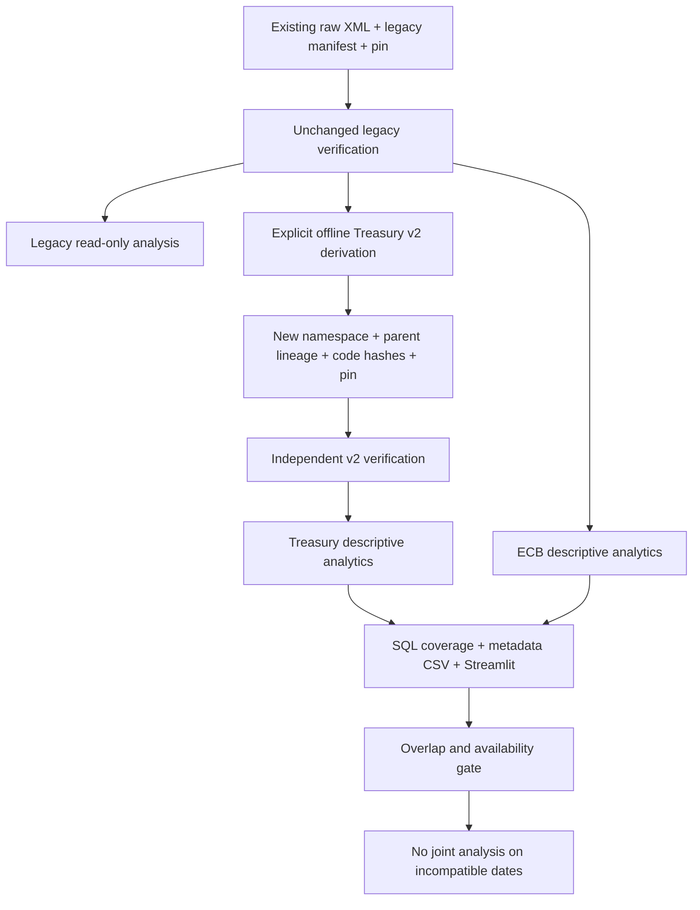
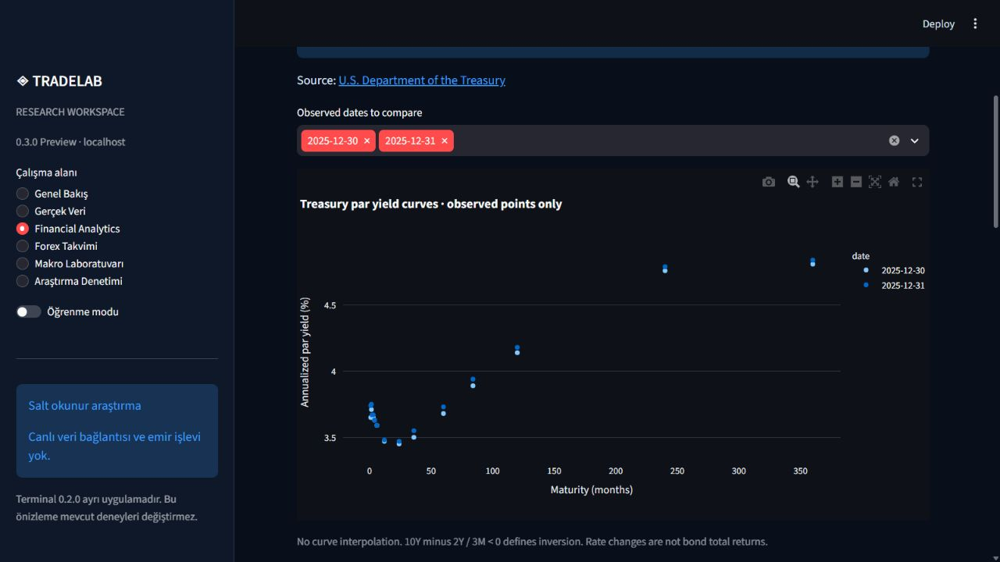
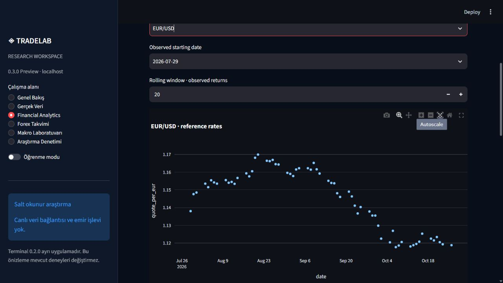

# Financial Analytics methodology

## Verified inputs and scope

The Financial Analytics section independently re-reads legacy snapshots through the
unchanged verifier and Treasury v2 through its own verifier. Failed snapshots are
shown as rejected; unavailable sources produce no substituted charts. Pure calculation
functions consume these verified entries and additionally validate status, units,
dates, finite values and duplicate keys. They are not a cryptographic boundary for
arbitrary Python callers. Synthetic fixtures are used only by tests and explicitly
labeled when exercised through the UI.

This is descriptive daily reference analysis, not investment advice, a prediction,
a trading system, or a historical information-vintage backtest. Separate versions
are never pooled. Raw data remains outside Git.

## Treasury

Par yields y are annualized percentages. Maturities are represented in months:
1, 1.5, 2, 3, 4, 6, 12, 24, 36, 60, 84, 120, 240 and 360. Curves use available
observed points with no interpolation. Users select valid observation dates to compare.

- 10Y–2Y spread in bp = 100 × (y10 − y2).
- 10Y–3M spread in bp = 100 × (y10 − y3m).
- An observed inversion is a strictly negative spread. Zero is not inverted;
  an absent leg produces no spread or inversion classification.
- Change in bp = 100 × (current yield − preceding observed-date yield).
  Thus 4.00% to 4.10% is +10 bp, not 10% profit.

The preceding date is the preceding date in that version's union of observations.
Missing maturity cells are not filled. Intervals crossing a known missing publication date suppress basis-point changes. Date intervals are reported: a multi-day
interval must not be interpreted as a measured one-calendar-day move. No duration,
price, accrued coupon or reinvestment model is used, so no bond total return is inferred.

## ECB FX

q is quote-currency units per EUR. EUR/USD rising from 1.00 to 1.10 means EUR
appreciation against USD, not USD appreciation.

- Simple change in percent: 100 × (q_t / q_previous − 1).
- Log change: ln(q_t / q_previous), expressed as a decimal.
- Cumulative change: 100 × (q_t / q_selected_start − 1).
- Rolling descriptive volatility: sample standard deviation of the last w log
  changes, denominator w−1. Default w=20; at least w valid changes are required.
  It is **not annualized**. No unstated 252-session assumption is applied.

The first selected date has no return, and choosing a starting date resets the
history and rolling warm-up. An observation interval spanning a known missing
scheduled/series date produces missing simple/log changes and breaks the rolling
window. Weekend intervals remain observed-date intervals, not zero returns.
Outside reviewed calendar scope, absence cannot be certified; interval day counts
and an unreviewed-calendar status remain visible. Such changes are excluded from
rolling volatility. Cumulative endpoint change remains descriptive even if an interior
observation is missing. No future rows enter preceding rolling estimates.

## Compatibility and exports

Current Treasury 2025 and ECB July–October 2026 have no shared dates. The UI displays
INSUFFICIENT OVERLAPPING VERIFIED DATES. Even overlapping dates do not automatically
enable joint analysis: definition and availability review remains required. No
correlation is fabricated. Collection/derivation timestamps are not historical
publication timestamps.

CSV downloads contain version, manifest hash, source URL, units, collection and
availability timestamps and transformation/window settings, analytic-code/reference hashes and a synthetic flag. SQL coverage aggregates
actual observations per series in an in-memory query-only database. Null values
remain blank; text cells are guarded against spreadsheet formula injection.

## Running the lab

Run the existing Streamlit workspace and select Financial Analytics. With no data,
all views remain functional and show unavailable status. Existing legacy snapshots
may be read from the default real_data directory, or from a user-selected local
folder set through TRADELAB_REFERENCE_STORE. This is a read-only path, not a download.
The Treasury v2 store is separate: research_workspace/real_data_v2 (Git-ignored).

Offline derivation is explicit Python API use:

```python
from pathlib import Path
from research_workspace.treasury_v2 import derive
result = derive(Path("path/to/verified/legacy/version"), "verified_manifest_sha256")
```

Use the receipt's actual hash; do not copy the placeholder. The parent must pass
legacy review, including its original collector digest. Rejected old collectors
cannot be migrated by this function. No network collection occurs.

## Revised data flow



## Authentic screens

Captured from the running localhost application with independently verified existing
reference snapshots and the offline v2 derivative; not mockups or synthetic data.



