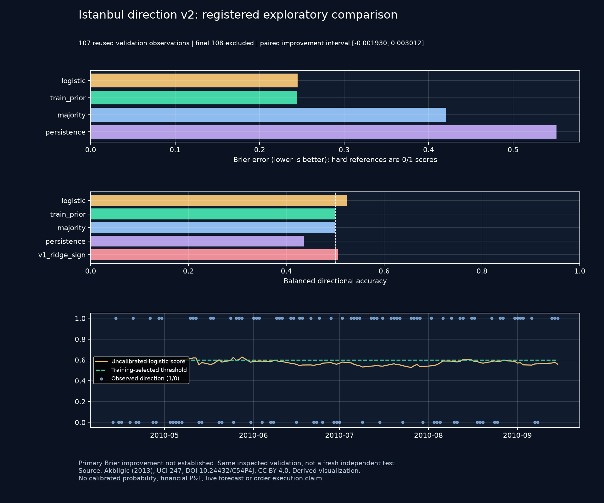

# Registered exploratory direction model v2: actual results

I developed a separate five-feature direction classifier with nested chronological selection, leaving the audited v1 model unchanged. The experiment asks a different question from continuous-return regression and reports all registered references, including unfavorable comparisons.

Registration chronology: local commits `03b2f95` and `a39e13d` recorded the protocol and numeric conventions; `c051581` recorded a convergence-roundoff guard exposed by a simulated test. All preceded the first real v2 evaluation. Implementation `263a4ed` preceded that evaluation. GitHub publication occurred after evaluation; this is not a claim of independently timestamped public preregistration. The outer validation period had already been inspected in v1, so **v2 is exploratory reused validation, not a fresh independent test**.

[Protocol](ISE_DIRECTION_V2_PROTOCOL.md) · [Pinned specification](../research_workspace/ise_direction_v2_spec.json) · [Exact results and all inner-selection traces](images/ise_direction_v2/results.json)

## What changed

The target is positive versus nonpositive Istanbul index return. The five features are target lag two, lag three, past-five mean, past-twenty mean and past-twenty standard deviation, all ending two observations earlier. This excludes foreign-index predictors and reduces model dimension from 22 features to five. It does not establish point-in-time publication vintage.

For each outer window, three chronological 50-row inner windows choose alpha from 1/10/100 by Brier score, then a decision threshold from 0.4/0.5/0.6 by balanced accuracy. Each inner scaler is fitted on its own training subset. Ties, single-class behavior and solver tolerance were fixed before the real run. Later windows can reuse earlier completed observations; current/future outer labels cannot select their own model.

All six real outer windows selected **alpha 100 and threshold 0.6**. These values were not chosen after examining outer performance. The complete candidate losses, indices, convergence statuses and threshold scores remain in the result JSON. No subsequent retuning was performed.

## Actual comparison on 107 observations

The dates remain 13 April–15 September 2010. The final 108 observations are excluded from fitting, selection, scores and charts.

| Registered reference | Brier, lower better | Log loss, lower better | Direction accuracy | Balanced accuracy | Positive prediction share |
| --- | ---: | ---: | ---: | ---: | ---: |
| v2 logistic | 0.244977 | 0.683060 | 45.79% | 52.31% | 9.35% |
| Smoothed training frequency | 0.244741 | 0.682615 | 57.94% | 50.00% | 100.00% |
| Hard training majority | 0.420561 | 11.620532 | 57.94% | 50.00% | 100.00% |
| Hard lag-two persistence | 0.551402 | 15.235803 | 44.86% | 43.58% | 57.01% |
| Unchanged v1 Ridge sign | n.a. | n.a. | 56.07% | 50.52% | 85.05% |

The v1 regression output is not a probability and has no Brier/log-loss entry. Hard 0/1 references use the preregistered 1e-12 log-loss clipping; they are not calibrated probabilistic forecasts. The primary comparator is the smoothed training frequency, not whichever reference looks weakest.

**Primary Brier improvement was not established.** The difference relative to training frequency is **-0.00023595**, with a paired 20-row moving-block 95% interval **[-0.00193038, 0.00301247]** (500 replicates, seed 7). The candidate is slightly worse on the primary metric and its interval includes zero. Balanced accuracy increases compared with v1, while plain accuracy decreases substantially; reporting only the favorable metric would be misleading.

The classifier emits 10 UP_RESEARCH and 97 NONPOSITIVE_RESEARCH labels. Those are historical classifications, not orders. Its five-bin ECE is 0.01047, but 97 observations lie in one score bin and only 10 in another. That small, concentrated sample does not validate probability calibration. No probability publication or trading approval is granted.



## Leakage and overfitting checks

Sixteen model/evaluation tests cover independent finite-difference optimization, training-only scaling, explicit constant-class fallback, deterministic ties, held-out suffix changes, current/future-label exclusion, visible-prefix invariance, spec drift, nonfinite inputs and failed convergence. Six interface/CLI tests cover explicit actions, replay bound 428, no refit on inspection, stale-report invalidation, cache tampering, local-only source loading and sanitized errors.

A simulated fold exposed an objective-rounding plateau just above the gradient tolerance. The corrected endpoint guard still requires the original 1e-8 gradient tolerance; no unfinished model is accepted. This numeric correction was recorded before real evaluation.

The output includes training Brier/log loss, selected inner Brier, outer Brier, gaps and coefficient norms for every window. These are descriptive fit diagnostics, not proof that overfitting is absent. Bounded nested selection limits direct computational leakage but cannot remove the effects of repeatedly inspected data, model-family choice or source preprocessing.

Actual application smoke checks reproduced the first real result exactly: three charts, 107 evaluated rows, unchanged source files, no automatic fit on load and no refit when selecting another historical observation. Five v1 source/protocol files remain byte-identical to baseline `055e436`; frozen V4/V4.1 files are separately checked. [Machine-readable verification](../evidence/ise_direction_v2_checks.json)

## Reproduction

Use the existing pinned private UCI source described in [the original lab](ISTANBUL_ML_LAB.md). No new account, scraper, broker key or collection endpoint is added.

```powershell
python -B tools/ise_direction_v2_research.py --snapshot C:\PrivateTradeLabData\uci247_v001
python -B tools/build_ise_direction_v2_report.py --snapshot C:\PrivateTradeLabData\uci247_v001 --output docs/images/ise_direction_v2
```

In the local workspace, select **Istanbul ML v2**, explicitly load the verified folder, then run the registered experiment. Source and specification identities bind the in-memory report; changes invalidate it. The chronological inspector displays logit contributions, not changes in a calibrated probability.

Source attribution: **Akbilgic, O. (2013), ISTANBUL STOCK EXCHANGE, UCI 247, DOI [10.24432/C54P4J](https://doi.org/10.24432/C54P4J), CC BY 4.0.** This report and chart are attributed derivatives. The source is historical index returns, not individual-stock OHLCV. No economic P&L is computed. All reserved periods, V4.1 and its time gate remain unchanged; no orders were sent.
