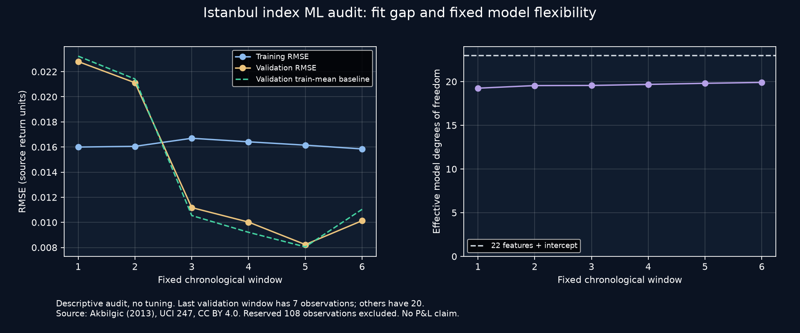

# Statistical overfitting assessment

Audit baseline: `0677c85`. This assessment uses published validation summaries and the fixed protocol. It does not open the reserved 108 observations, tune the model or score another period. The findings concern retrospective index-return research, not individual-stock trading performance.

## What the published evidence establishes

The first training window contains **297 observations**, not 321: the 22-row feature warm-up and two-row purge are removed. The last window contains 397. There are 22 standardized features and an unpenalized intercept. The first window therefore has 13.5 observations per feature before accounting for dependence; this is a descriptive ratio, not a statistical adequacy threshold or an effective sample size. Ridge regularization reduces flexibility, but a parameter count alone does not measure effective degrees of freedom.

Across 107 validation observations:

- Ridge reduces MSE relative to the training-mean reference by approximately **0.52%**, but has approximately **0.68% greater MSE than the zero predictor**. The tiny mean-reference improvement is not evidence that adding 22 features is useful.
- The paired MSE-improvement interval `[-1.1603e-5, 1.6079e-5]` includes zero. It is a small-sample, serial-dependence-aware diagnostic, not a significant-alpha result.
- The model predicts a positive return in **91 of 107 observations**. Positive-class recall is **85.48%**; nonpositive-class recall is **15.56%**. Its 56.07% plain accuracy becomes only **50.52% balanced accuracy**. The training-mean reference obtains 57.94% plain accuracy by predicting the majority direction.
- Three validation windows improve MSE relative to training mean and three worsen it. The final window contains only **seven observations**; its 71.43% accuracy should not be promoted as a stable regime result.
- LONG has 19 observations, WATCH 72 and CASH 16. Their observed positive shares do not form evidence that the LONG threshold identifies a better trading opportunity. These are post-hoc descriptive groups, not calibrated forecast probabilities or economic P&L.

Exact inputs for these calculations are [the validation summary](images/ise_ml/ise-ml-validation.json) and [the descriptive audit](images/ise_ml/ise-ml-diagnostics.json). No new market observations were examined for this assessment.

## What cannot be concluded from those summaries

**Poor validation does not by itself prove overfitting.** At the audit baseline, exported reports do not contain training errors, an out-of-sample generalization gap, effective degrees of freedom or coefficient stability. Low predictive signal, an overly simple model, sampling variation and distribution changes can also produce weak validation results. Conversely, passing causal-code tests does not prove that the model generalizes.

Train and validation scores are distinct diagnostic evidence; official [validation-curve guidance](https://scikit-learn.org/stable/modules/learning_curve.html) discusses bias, variance and noise separately. The project uses a custom NumPy Ridge solver; citing this reference is not a claim that scikit-learn executed or certified the experiment. [Ridge documentation](https://scikit-learn.org/stable/modules/generated/sklearn.linear_model.Ridge.html) describes the regularized objective and intercept behavior used as a mathematical reference.

## Bounded follow-up that does not retune

For each already registered training window, an audit can record training-only RMSE/MAE and the existing validation-window errors. It can also record the fixed standardized coefficient norm and the effective degrees of freedom of that training design. Those values must use only the same eligible training rows; reserved observations are unnecessary. Coefficient summaries across windows are descriptive because standardization and training distributions change.

Any such instrumentation must leave all original predictions, labels, thresholds, model parameters and validation rows unchanged. Training-fit improvements are not a reason to select another penalty from this inspected validation set. A train/validation gap can support an overfitting concern; it cannot be translated into a universal cutoff or an automatic trading-release approval.

The validation period has now been repeatedly inspected. Additional diagnostics are explicitly exploratory; they do not turn this period into a fresh independent test. Any new model or threshold requires a separate registered specification and separately justified future evaluation evidence. The reserved ISE rows, BIST-stock 2025 holdout and V4.1 time gate remain closed. No orders, probability release or profitability claim follows from this audit.

## Implemented integrity corrections

The adversarial engine audit reproduced nine assertion failures before correction. Direct evaluation accepted changes to the Ridge penalty or signal threshold under the unchanged v1 registration, float aliases for partition integers and contradictory count/byte/order metadata. These were registration enforcement gaps, not evidence of future labels entering the current model.

`validate_registration` now validates the in-memory dataset and exact metadata types without fitting. The fixed v1 model descriptor rejects parameter drift; the summary separately identifies model specification and experiment hashes. A derived binding covers the source registration, exact byte/row/partition/order fields and model descriptor. Source registration identities and existing immutable on-disk snapshots are preserved: read-back reconstructs the binding from verified original bytes. Already-loaded old sessions must reload; no original manifest is rewritten.

Four cache failures were reproduced: changed loaded data, changed source metadata, changed summary/holdout flags and changed explanation cutoffs could be displayed without evaluation's checks. Each display now verifies source registration and a lossless digest of summary, curve values, index, types and nested contributions. A one-ULP contribution mutation is also rejected. Failure clears both report and loaded state before rendering metrics or charts; inspector interaction still does not refit. This detects accidental inconsistent state, not an owner who controls code and can recompute all digests.

## Measured training/validation audit

The same existing fits now export training RMSE, matching validation errors, coefficient norm and effective degrees of freedom. No additional model is trained or selected. The Ridge effective degrees of freedom are computed as `1 + sum(s² / (s² + 10))` from singular values of the centered, training-standardized feature matrix; the intercept is unpenalized. An independent trace-of-hat-matrix calculation tests that quantity.

| Window | Training observations | Validation observations | Training RMSE | Validation RMSE | Effective degrees of freedom |
| --- | ---: | ---: | ---: | ---: | ---: |
| 1 | 297 | 20 | 0.015997 | 0.022804 | 19.245 |
| 2 | 317 | 20 | 0.016055 | 0.021119 | 19.543 |
| 3 | 337 | 20 | 0.016696 | 0.011177 | 19.557 |
| 4 | 357 | 20 | 0.016414 | 0.010022 | 19.678 |
| 5 | 377 | 20 | 0.016149 | 0.008233 | 19.804 |
| 6 | 397 | 7 | 0.015846 | 0.010134 | 19.904 |

[Exact fit audit](images/ise_ml/ise-ml-fit-audit.json). The original validation metrics, labels and source registration are unchanged, and all three source files have identical before/after hashes. The first two windows have higher validation errors, while the remaining four have lower errors. This mixed pattern can reflect distribution changes as well as model fit; it does **not** establish a uniform overfitting diagnosis or prove its absence. Combined with weak baseline comparisons, small dependent samples and repeated validation inspection, the model remains unvalidated for trading.
