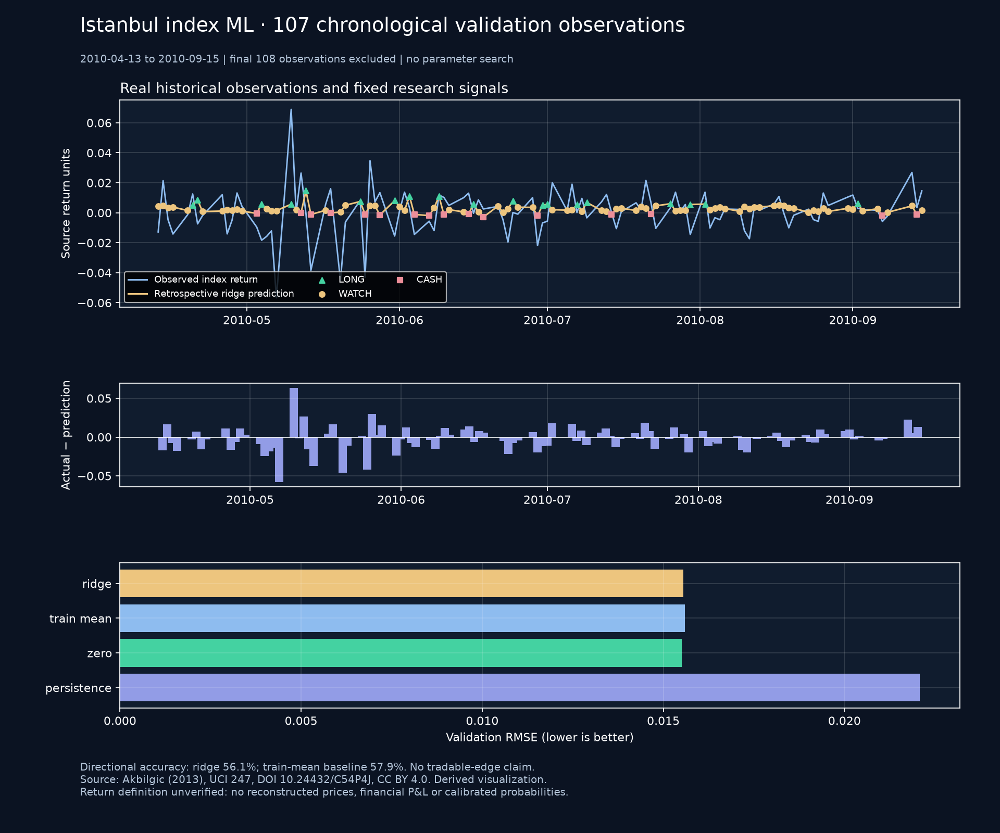

# Real-data Istanbul index machine learning lab

I built and ran a complete historical ML workflow on a small openly licensed dataset, rather than presenting synthetic tests as market evidence. The application loads a source-pinned snapshot, evaluates a fixed chronological model, plots observed returns and predictions, annotates historical research signals and explains their largest linear feature contributions.

This is **index-return research**, separate from the entitled-CSV BIST stock lab. It does not supply THYAO/GARAN/ASELS OHLCV, current forecasts or executable prices. The [specification](ISE_ML_PROTOCOL.md) was committed at `4c66624` before downloading observations. Implementation was recorded at `d9ba5cd` before the actual evaluation.

## Source and reproducibility

Source: **Akbilgic, O. (2013). ISTANBUL STOCK EXCHANGE [Dataset]. UCI Machine Learning Repository. DOI [10.24432/C54P4J](https://doi.org/10.24432/C54P4J), CC BY 4.0.** [Dataset and license](https://archive.ics.uci.edu/dataset/247/istanbul+stock+exchange). The report and figure are attributed adaptations of that source.

The original workbook contains 536 daily observations, two Istanbul return columns labeled TL/USD and seven foreign-index return columns. Actual dates are **5 January 2009–22 February 2011**. The landing page's June start conflicts with the workbook and original paper; that discrepancy is retained in the record. The author paper discloses previous-value filling for foreign indices. No additional imputation is performed.

The archive SHA-256 is pinned to `a30838316290a83a98a52a46c30174e0204c963c0877627954ebc74111668922`. Normalization produces `5c0b89dd85cc6a9af4c9e53b1cdf14ca00e961de40e50aaa968a1262e7b1dcb6`. A standard-library ZIP/XML parser and independent bundled pandas workbook reader produced identical CSV bytes. Parsing rejects formulas, external worksheet references, unexpected headers, excessive decompression and invalid dates/numbers.

Collection is an explicit bounded HTTPS GET to a fixed UCI URL, with no redirects or automatic retries. Source changes fail closed. Registration creates a new folder outside Git using exclusive writes. Read-back rebuilds normalized CSV from the pinned archive and checks raw, normalized, canonical and registration hashes. Original full data remain outside Git, including the reserved observations. Byte identity is not independent proof of historical publication vintage.

```powershell
python -B tools/ise_ml_research.py collect --output C:\PrivateTradeLabData\uci247_v001 --allow-download
python -B tools/ise_ml_research.py evaluate --snapshot C:\PrivateTradeLabData\uci247_v001
$env:TRADELAB_ISE_SNAPSHOT='C:\PrivateTradeLabData\uci247_v001'
python -B -m streamlit run research_workspace/app.py --server.address 127.0.0.1 --server.port 8504 --browser.gatherUsageStats false
```

Select **Istanbul ML**, load the registered folder explicitly, then select **Görünür dönem için modeli ve sinyalleri değerlendir**. Loading alone never fits a model. The replay cursor is capped at 428 observations. Changing replay/source or explicitly reloading invalidates the report; display-only inspector interaction reuses the same evaluated report without another fit. Failed reload removes the prior snapshot, and local filesystem access requires an explicit loopback bind. The immutable in-memory snapshot is identified by registration hash; reload explicitly to inspect files again.

## Fixed model, actual evidence

Development: first 321 observations. Validation: next 107 observations, **13 April–15 September 2010**. Final 108 observations are not fitted, scored or charted. Features use two- and three-observation lags plus past rolling target statistics. Training-only standardization, fixed Ridge penalty 10, two-row purge and expanding 20-observation blocks prevent the implemented prediction from using same-day/future target inputs. No hyperparameter search occurred.

| Model | RMSE, source units | MAE, source units | Directional accuracy | Balanced accuracy |
| --- | ---: | ---: | ---: | ---: |
| Ridge | 0.015559 | 0.011041 | 56.07% | 50.52% |
| Training mean | 0.015599 | 0.010573 | 57.94% | 50.00% |
| Zero | 0.015506 | 0.010633 | 42.06% | 50.00% |
| Lag-two persistence | 0.022086 | 0.016101 | 44.86% | 43.58% |

The paired squared-error improvement over training mean is `1.2684e-6`; its 95% moving-block interval is `[-1.1603e-5, 1.6079e-5]` (20 observations/block, 500 replicates, seed 7). It includes zero. Ridge loses to the training-mean reference on directional accuracy and to zero on RMSE. **No reliable predictive advantage or tradable edge is established.** These weak results are published without retuning the protocol.

Historical labels: **19 LONG, 72 WATCH, 16 CASH**. LONG means prediction >0.005 source units, WATCH is positive up to that threshold, and CASH is nonpositive. The threshold is a fixed research heuristic, not a verified transaction-cost threshold. No calibrated bullish probability is reported. Per-observation explanations identify training/feature cutoffs and the three largest signed model contributions; those are a partial arithmetic decomposition, not economic causality.



[Exact actual results](images/ise_ml/ise-ml-validation.json) · [Software/source evidence](../evidence/ise_ml_checks.json)

The [post-hoc stability and signal audit](ISE_ML_DIAGNOSTIC_AUDIT.md) adds a per-observation inspector, six-window performance table, confusion counts and descriptive signal-group outcomes. It is explicitly exploratory and leaves the original model and results unchanged.

The subsequent [leakage and overfitting audit](ISE_OVERFIT_AUDIT.md) enforces fixed model settings, exact metadata binding and lossless cache integrity on every display. It adds training/validation error gaps and effective model degrees of freedom from the same fits. Original source files and validation predictions remain unchanged. Older open sessions need an explicit reload to obtain the new in-memory validation binding; their disk manifests are preserved.

## What is and is not tested

The public tests include independently calculated Ridge predictions, train-only scaling, changed-target and future-suffix invariance, holdout exclusion, metadata changes, malformed archives, source substitution, deterministic resampling and explicit UI/replay behavior. A separate smoke check ran the actual registered data through the full application: three charts, 107 scored rows, cursor maximum 428 and no reserved-period output.

The source does not clearly establish simple versus log-return construction. Therefore there is **no compounded price reconstruction, financial P&L or claimed cost-adjusted backtest** for this dataset. Historical signals are a replay research result, not forecasts issued in 2010 or a current trading system. Source preprocessing and vintage limits remain despite causal code.

The next independent research need is more permitted, timestamped price/corporate-action data, a larger untouched evaluation period and an economically defined benchmark/cash return. Any new model, threshold or data period needs a separate registered specification. Existing V4.1, its **21 January 2027 21:15 UTC** gate, the Stage 7 cutoff and the BIST-stock 2025 holdout are unchanged. No order path was added or used.
